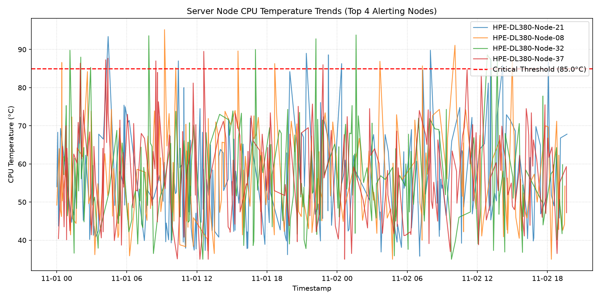

# Server Thermal Telemetry & Alert Monitor

An automated Python telemetry pipeline built with **Pandas** and **Matplotlib** to ingest, analyze, and visualize hardware sensor logs across a 48-node server cluster. Designed to detect cooling anomalies before hardware thermal throttling or shutdown occurs.

## Problem Statement
Manually inspecting BMC/iLO thermal and power logs across dozens of rack servers is error-prone and takes ~15 minutes per batch. Delayed detection of fan stalls under high compute loads leads to CPU thermal throttling and degraded cluster performance.

## Key Features
- **High-Speed Batch Processing:** Processes 10,000+ rows of multi-node sensor telemetry (CPU °C, Fan RPM, Power Load W) in **< 0.5 seconds** using vectorized Pandas operations.
- **Automated Anomaly Detection:**
  - **Overheating Alert:** Flags CPU temperatures >= 85°C.
  - **Fan Stall Alert:** Flags fan speeds <= 1,200 RPM while node power draw exceeds 150W.
- **Actionable Reporting & Visualization:** Exports filtered incident logs to `output/thermal_alerts_report.csv` and plots multi-node temperature trends against critical thresholds in `output/node_temperature_trends.png`.

## How to Run
1. Install dependencies:
   ```bash
   pip install -r requirements.txt
   ```
2. Generate simulated 48-node telemetry data:
   ```bash
   python src/generate_telemetry.py
   ```
3. Run the thermal monitor and generate reports:
   ```bash
   python src/monitor_thermals.py
   ```

## Sample Output
